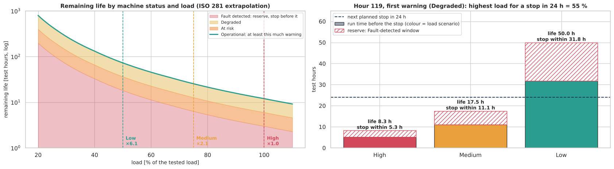
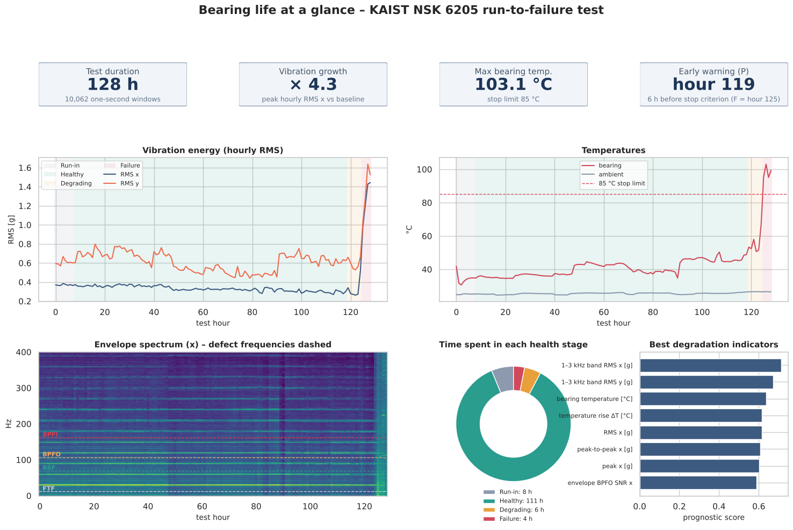
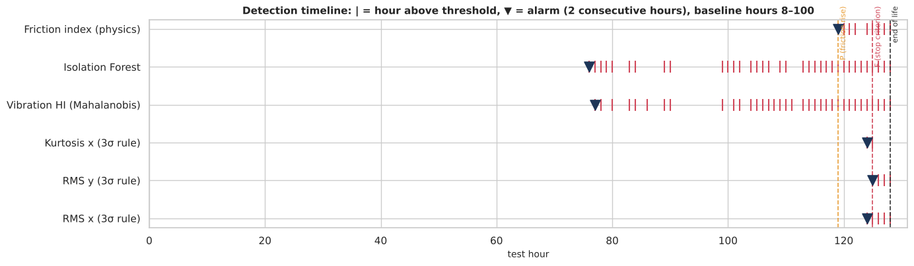
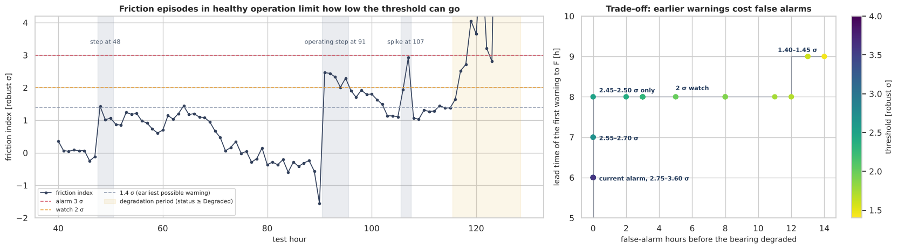
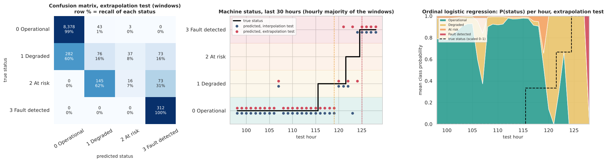
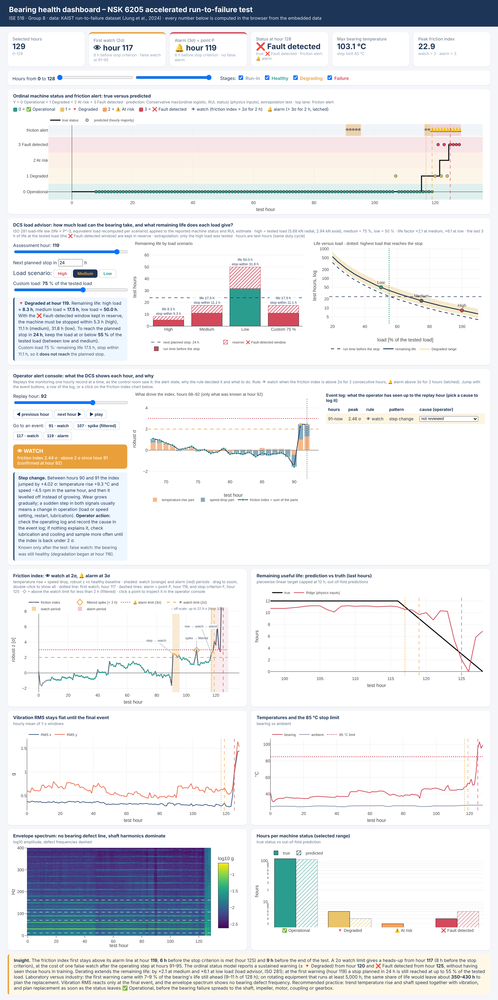

# Ball-Bearing Prognostics from Run-to-Failure Data
**Early Degradation Detection, Ordinal Machine-Status Classification and Remaining Useful Life (RUL) Estimation**


**ISE 518 – Data Analytics for Reliability and Maintenance** · King Fahd University of Petroleum & Minerals · First Semester 2026-27
**Instructor:** Dr. Alaa Khamis · **Group 8**

| Member | Student ID |
|---|---|
| Mohammed Alsulami | 202612840 |
| Bassam Alawam | 202612700 |
| Nasser Alasmari | 201765530 |
| Mohammad Almarhoon | 201914630 |

| Notebook | Interactive dashboard (machine status, alarms, DCS load advisor) |
|---|---|
| [](https://colab.research.google.com/github/alsulami412-arch/ISE518-Bearing-RUL/blob/main/ISE518_G8_Bearing_EDA_RUL_V3.ipynb) | [View dashboard](https://raw.githack.com/alsulami412-arch/ISE518-Bearing-RUL/main/dashboard/bearing_dashboard.html) · [mirror](https://htmlpreview.github.io/?https://github.com/alsulami412-arch/ISE518-Bearing-RUL/blob/main/dashboard/bearing_dashboard.html) |

Sections 1–6 follow the **six EDA instructions** of the assignment: data loading, cleaning and preparation, univariate analysis,
multivariate analysis, time-series and trend analysis, and visualization. Section 7 adds model development, evaluation and
deployment (Steps 5–7 of the course's 7-step procedure), including the DCS load advisor and the interactive dashboard.
Open it in Colab and choose *Runtime → Run all* (about 3–4 minutes). All data is loaded from this repository by URL.

## Output: an ordinal machine status, with load scenarios for the DCS
The model output $Y(t)$ is not a binary healthy / failed flag but a **four-level ordinal machine status** (an ordinal label, as in
Lecture 9), label-encoded 0 < 1 < 2 < 3. Because the remaining life depends on how hard the machine is driven, it is given for
three **load scenarios** that the DCS operator can choose: **high** = the tested load (5.88 kN radial, 2.94 kN axial),
**medium** = 75 % and **low** = 50 % of it.

| Y | Machine status | Condition of the bearing | RUL at high load (as tested) | at medium load (75 %) | at low load (50 %) | DCS action |
|:-:|---|---|---|---|---|---|
| 0 | ✅ **Operational** | normal operation | more than 12 h | more than 25 h | more than 73 h | any load up to high; continue normal monitoring |
| 1 | 🔻 **Degraded** | degradation has started (inside the P–F interval) | 6 – 12 h | 13 – 25 h | 36 – 73 h | limit to medium load; plan the replacement |
| 2 | ⚠️ **At risk** | failure is imminent | 3 – 6 h | 6 – 13 h | 18 – 36 h | limit to low load; replace at the next opportunity |
| 3 | ❌ **Fault detected** | stop criterion met (T > 85 °C and vibration > 9 m/s²) | 3 h or less | – | – | stop the machine and replace the bearing |

The status thresholds are hours of remaining life at the tested load. The medium and low columns apply the ISO 281 load–life
law for ball bearings (life ∝ P⁻³, with the equivalent load P = X·Fr + Y·Fa recomputed for each scenario): **×2.1 at medium and
×6.1 at low load**. Only the high load was tested, so these two columns are engineering extrapolations, not measurements.

### DCS load advisor
For the current machine status, the advisor (notebook Section 7.2, and interactive in the dashboard) gives the remaining life at
each load and the **highest load that still reaches the next planned stop**. The last 3 h of life at the tested load (the ❌ Fault
detected window, ≈ 6 h at medium and ≈ 18 h at low) end in functional failure, so they are kept in reserve. At the first warning
(hour 119, 🔻 Degraded):

| Load scenario | Remaining life | Must stop within | Reaches a stop planned in 24 h? |
|---|---|---|---|
| High (100 %, as tested) | 8.3 h | 5.3 h | no |
| Medium (75 %) | 17.5 h | 11.1 h | no |
| Low (50 %) | 50.0 h | 31.8 h | yes |

To reach a stop planned in 12, 24 or 48 h, the load must stay at or below **72 %, 55 % or 42 %** of the tested load. At the tested
load, the only one with ground truth, the advised stop always came before the end of life, with 2 to 4 h to spare.





## Main results
| Question | Answer from the data |
|---|---|
| When does degradation become detectable? | **Hour 119**: 6 h before the stop criterion was met (hour 125), 9 h before the end of the test, with no false alarms in 111 healthy hours. A 2σ *watch* level warns at **hour 117** (8 h before) at the cost of one false watch after an operating step (hours 91–95; the one-hour spike at hour 107 is filtered by the 2-hour rule); no threshold and no recorded signal can warn before hour 116 (P–F interval ≈ 9 h under this heavy test load). |
| Which signals reveal it first? | The **temperature rise above ambient** and the **drop in shaft speed** (estimated from the vibration spectrum) – both consequences of friction. Vibration RMS stays flat until hour 124. |
| How well can RUL be estimated? | Mean absolute error ≈ **2.5 h over the last 12 h** when the failure path is represented in training (ridge regression on physics inputs, vs 6 h for a naive baseline). For a never-seen failure no model beats the baseline by much, which shows the need for more run-to-failure data. |
| How reliably can the ordinal machine status be recognized? | Conservative combination of an **ordinal logistic regression** (`statsmodels`) and the status implied by a linear RUL trend: **quadratic-weighted κ = 0.89**, mean error 0.08 levels, 0.8 % of windows two or more levels off. Every ❌ Fault detected window is recognized even when no fault was in the training data; the two middle levels are often confused with their neighbours |
| How much load can the bearing take after a warning? | Derating is the operator's strongest lever: **×2.1 remaining life at 75 % load and ×6.1 at 50 %** (ISO 281). At the first warning the bearing had 8.3 h of life at the tested load, 17.5 h at medium and 50 h at low; a stop planned in 24 h is still reached at up to **55 %** of the tested load. Medium and low are extrapolations from a single-load test. |







## Interactive dashboard
The notebook writes a self-contained dashboard, `dashboard/bearing_dashboard.html`, with the machine status, the two-level
friction alarm, the DCS load advisor, an **operator alert console** and the condition indicators. The console replays the
monitoring hour by hour as the control room saw it: the alert state (normal, pending, 👁 watch, 🔔 alarm), why the rule decided it,
what drove the friction index (temperature rise or speed drop) and what to do, with an event log where the operator records the
cause of each event. For example, hours 91–95 raised a watch because the index stayed above 2σ for five hours after a step change
in temperature and speed (an operating change: a false watch), while the 2.93σ peak at hour 107 lasted only one hour and was
filtered by the 2-hour rule. GitHub cannot run interactive charts, so open it in the browser: **[interactive dashboard](https://raw.githack.com/alsulami412-arch/ISE518-Bearing-RUL/main/dashboard/bearing_dashboard.html)** (or click the snapshot).

[](https://raw.githack.com/alsulami412-arch/ISE518-Bearing-RUL/main/dashboard/bearing_dashboard.html)

## Data
**Ball Bearing Vibration and Temperature Run-to-Failure Dataset** (KAIST): an NSK 6205 ball bearing run to failure under
2.94 kN axial and 5.88 kN radial load at ~1780 rpm. 129 hourly files, each 78.125 s at 25.6 kHz with x/y vibration,
bearing temperature and ambient temperature (18.5 GB in total).

* W. Jung, S.-H. Yun, Y.-H. Park, *Data in Brief* 54 (2024) 110403, doi:10.1016/j.dib.2024.110403
* Mendeley Data, doi:10.17632/5hcdd3tdvb.6, licensed CC BY 4.0

The raw files are not stored here. `pipeline/build_features.py` downloads them from Mendeley Data, checks their quality
and aggregates every 1-second window into time-domain, frequency-domain and envelope (bearing-defect) indicators.
The workflow in `.github/workflows/build-features.yml` ran it on GitHub's servers (about 9 minutes). To rebuild locally:

```bash
pip install numpy pandas scipy requests
python pipeline/build_features.py --download --out data/processed
```

## Running the notebook locally
```bash
pip install -r requirements.txt
jupyter notebook ISE518_G8_Bearing_EDA_RUL_V3.ipynb
```

## AI use
The methods, equations and evaluation choices were selected by the group from the ISE 518 lectures (the 7-step machine-learning
procedure, the P-diagram, ordinal machine status and feature encoding, descriptive statistics, outlier rules, unsupervised learning,
correlation analysis and data-driven prognostics) and from the books, standards (ISO 281, ISO 10816, API 610) and academic articles
listed in the notebook's references. In line with the course guidance on generative AI, the group discloses that Claude (Anthropic)
generated the code and first drafts of the text from these inputs: for each step the group specified the method, the equation and the
expected output, reviewed the results, and asked for corrections where they did not fit the course methods or the operators' needs.
All results are produced by running the code on the real dataset in Google Colab. See the *AI use and reflection* section at the end of
the notebook for the lecture-by-lecture list and the group's reflection.

## From a laboratory test to industrial equipment
This project is a **laboratory, accelerated test**: the bearing carried about 45 % of its dynamic load rating and reached the end
of its life after only 128 test hours. In industry, rotating equipment is expected to run **at least 5,000 h** when the maintenance
procedures are carried out and the team complies with them, which is what ensures quality and safe operation (a conservative
figure: API 610 requires process-pump bearings to have an L10 life of at least 25,000 h).

| | This laboratory test | Rotating equipment in industry |
|---|---|---|
| Life of the bearing | 128 test hours (accelerated, heavy load) | at least 5,000 h |
| Warning before the end of life | 9–11 h = **7–9 % of the life** (watch at hour 117, alarm at hour 119) | **about 350–430 h** (15–18 days of continuous running) at the same share of life |

Measured against its own life, our model detected the coming failure, and with the DCS load advisor could control it, close to
the last tenth of the bearing's life. Under the ISO 281 load–life law a lighter load stretches every phase of the life by the same
factor, so in service the warning keeps roughly the same share of the life: **hundreds of hours to plan** the replacement, order
the bearing, fit the job into a planned shutdown and derate in the meantime, instead of an unplanned stop.

**What the early warning saves.** The warning came 6–8 h before the stop criterion, that is, before the bearing failed
functionally. Acted on, it turns the failure into a planned bearing change and saves the rest of the machine from secondary
damage: the **shaft**, which a seized or collapsing bearing scores and overheats until it needs a long overhaul; the **impeller
and its vanes**, wear rings and seals, which are damaged when the rotor rubs; the **motor**, which is overloaded; and whatever
else is connected to the rotating equipment, such as the **coupling, pulley and belts or the gearbox**. A bearing and a short
planned stop cost far less than these parts and the long overhaul they would need.

These figures are an engineering extrapolation from one laboratory bearing, so the thresholds should be confirmed with plant
history before the model is used in service.
